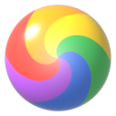
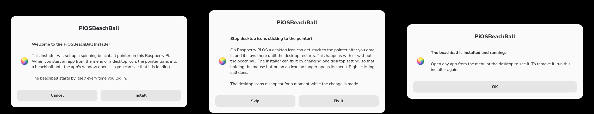

<p align="center"></p>

<h1 align="center">PiOSBeachBall</h1>

<p align="center"><b>A spinning beachball for the Raspberry Pi.</b><br>A friendly installer that sets up a beachball pointer on a Pi 4, 400, 5 or 500, so you can see when an app is loading.</p>

<p align="center"><a href="../../releases/latest"><b>Download for Raspberry Pi OS</b></a></p>

<p align="center">Discord: <a href="https://discord.gg/88VzuWSYUc">https://discord.gg/88VzuWSYUc</a></p>

## What it does

Raspberry Pi OS gives no sign that an app is on its way. A big program can take many seconds to open from an SD card, and until its window appears the desktop looks as if the click never landed. PiOSBeachBall fills that gap. When an app started from the menu or a desktop icon has no window yet, the pointer becomes a spinning beachball until the window appears or the app exits.

## Features

- **A proper installer.** A welcome screen, a progress bar, one optional fix and a finished screen, built from the dialogs Raspberry Pi OS already has. No terminal needed.
- **Works from the menu and the desktop.** Apps started from the main menu, a desktop icon or a file manager window all get the beachball.
- **Spins on the Pi 5 and Pi 500.** The hardware cursor on those models holds the first frame of an animated cursor. The beachball is drawn over the screen instead, so it turns on every model.
- **Gets out of the way.** It goes when the app's window opens, when the app exits, when you click, or after three minutes.
- **Light.** It costs about half a percent of one core on a Pi 400 while idle.
- **Starts at login.** It is there every time the desktop starts, for the user who installed it.
- **Fixes icons that stick to the pointer.** The installer offers to change the desktop setting behind a Raspberry Pi OS glitch, where a dragged desktop icon stays stuck to the pointer. Skip it if you would rather not.
- **Reinstall or remove.** Run the installer again.



## Install

1. Download `PiOSBeachBall.tar.gz` from the [latest release](../../releases/latest) and extract it. In the file manager, right-click the file and choose Extract Here.
2. Open the `PiOSBeachBall` folder, double-click `install.sh` and choose Execute.
3. Choose **Install**. The installer then offers to stop desktop icons sticking to the pointer; choose **Fix It** or **Skip**.
4. Open any app to see the beachball.

From a terminal the same thing is:

```bash
tar -xzf PiOSBeachBall.tar.gz && PiOSBeachBall/install.sh
```

It needs Raspberry Pi OS 13 (trixie) with the standard labwc (Wayland) desktop. The X11 session is not supported. The installer adds one small system package, `gir1.2-gtklayershell-0.1`, if the Pi does not have it, which takes an internet connection.

To remove the beachball, run the installer again and choose **Remove**, or run `PiOSBeachBall/install.sh --uninstall` from a terminal.

## How it works

`pibeachball.py` is a small Python program that runs in the background. It uses what Raspberry Pi OS already has, plus the layer-shell bindings.

- Apps started from desktop icons and file manager windows are children of `pcmanfm`. Apps started from the menu are launched through GLib, which tags them with `GIO_LAUNCHED_DESKTOP_FILE_PID`. The program polls `/proc` five times a second for either.
- If the app has no window after 0.3 seconds, a transparent overlay covers each screen, hides the pointer and draws the spinning beachball under it.
- New windows are picked up through the `wlr-foreign-toplevel` Wayland protocol, the same one the taskbar uses. The beachball goes away when a new window maps, when every process belonging to the app has exited, when you click, or after three minutes.

A click while the beachball is showing dismisses it and does not reach the window underneath.

The installer copies the program and its frames to `~/.local/share/pibeachball` and adds an autostart entry at `~/.config/autostart/pibeachball.desktop`.

## Tuning

The constants at the top of `pibeachball.py` set the cursor size (`SIZE`), animation speed (`FRAME_MS`), how long an app gets before the beachball appears (`SHOW_DELAY`) and the safety cut-off (`TIMEOUT`). Run the installer again after editing and choose Reinstall.

## Checking it

```bash
python3 pibeachball.py --selftest
```

This launches `sleep 1` the way the menu does and the way the desktop does, and checks the beachball appears and clears for each.

To watch what the program detects, stop the running copy and start it in a terminal:

```bash
pkill -f pibeachball.py; python3 ~/.local/share/pibeachball/pibeachball.py
```

## Desktop icons sticking to the pointer

On Raspberry Pi OS Trixie a desktop icon can get stuck to the pointer after a drag, and it stays there until the desktop restarts. This comes from pcmanfm and happens with or without the beachball installed. Holding the mouse button on an icon for about half a second counts as a long press, which opens the icon's menu just as the drag starts, and the drag never finishes.

Limiting the long press to touchscreens stops it. The installer offers this as its last step, and skips the question on a Pi that already has the setting. Removing the beachball leaves the setting in place.

To make the change by hand, this adds `gestures_touch_only=1` to `~/.config/libfm/libfm.conf` and restarts the desktop icons:

```bash
sed -i '/^\[config\]/a gestures_touch_only=1' ~/.config/libfm/libfm.conf && pkill pcmanfm
```

The desktop starts pcmanfm again on its own. Restarting pcmanfm also frees an icon that is already stuck, and right-clicking still opens the menu.

## Building the beachball

`blender/make_beachball.py` builds the model and renders 36 frames at 128 px into `blender/frames`, one full clockwise turn in 10 degree steps, so the spin loops seamlessly at about 1.2 seconds per turn. `blender/beachball.blend` holds the scene. To render it again:

```bash
blender -b -P blender/make_beachball.py
```

A release is the installer, the program, the frames and the licence in one archive:

```bash
git archive --format=tar.gz --prefix=PiOSBeachBall/ -o PiOSBeachBall.tar.gz HEAD install.sh pibeachball.py blender/frames LICENSE
```

## Pi Projects

PiOSBeachBall is one of four projects for the Raspberry Pi. One is a utility for the desktop, and three bring favourite old free games to the Pi with the same kind of installer.

| Project | What it is |
| --- | --- |
| **PiOSBeachBall** | A spinning beachball pointer that shows when an app is loading. |
| [PiKnytt](https://github.com/jameshansen/PiKnytt) | Knytt, the 2006 exploration platformer by Nifflas, installed and ready to play. |
| [PiKlassOf99](https://github.com/jameshansen/PiKlassOf99) | Klass of 99, Richard Jordan's Skool Daze remake, installed and ready to play. |
| [PiPakoon](https://github.com/jameshansen/PiPakoon) | Pakoon 0, 1 and 2, Mikko Oksalahti's driving games, built for the Pi with a launcher to pick between them. |

## AI use disclosure

PiOSBeachBall was built using [Claude Code](https://claude.com/claude-code) with Claude Opus 5.5 and Claude Fable 5.2.

## Licence

PiOSBeachBall is free software under the [MIT licence](LICENSE).
